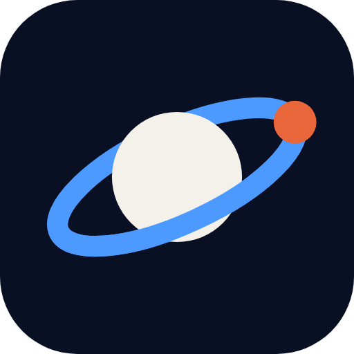

<div align="center">



# Frontier Labs

### Which place on Earth is the closest twin of the Moon or Mars?

Pick a site, add some real NASA data, and get a likeness score you can trust.

[](https://avmfrontierlabs.github.io/frontier-labs/)


**[Open the live site](https://avmfrontierlabs.github.io/frontier-labs/)**

Built by the AVM FrontierLabs team

</div>

---

## What it does

Scientists test rovers and train astronauts in places on Earth that look like other worlds. These are called analog sites. Frontier Labs measures how close a match each one really is. You name two sites, choose what to compare, and drop in one data file for each world. The lab then gives you a percent likeness with an honest uncertainty range.

You can compare three things:

| Subject | What gets checked |
| --- | --- |
| Temperature | How hot and cold the two sites get, day and night, through the seasons |
| Topography | Elevation, slopes and how rough the ground is |
| Surface composition | What the rocks and soil are made of |

## Try it in 30 seconds

1. Open the [live site](https://avmfrontierlabs.github.io/frontier-labs/).
2. Drag the Earth around and click a spot to see its closest analog site.
3. Press **Launch Comparer**, then **Load example** and **Analyze**.

No sign-up and no install.

## Who it's for

The "Who is exploring?" bar at the top changes the words, the sections and the panels to fit you.

| Mode | What you get |
| --- | --- |
| Kids | Simple words, big buttons and a built-in example |
| Students | Missions to watch, careers and citizen science |
| Educators | Lessons, worksheets and curriculum packages |
| Scientists | Full statistics, a similarity matrix and raw data export |
| Managers | A decision brief, market benchmarks and an investment analyzer |
| Auto-Detect | The standard view |

## How the score works

Each subject you switch on gets its own likeness from 0 to 100%. The overall likeness is a weighted mean that uses the importance sliders. Each subject's weight is divided by the total weight of the switched-on subjects. A slider at 0 means the subject is shown but isn't counted. The overall uncertainty range combines each subject's bootstrap results.

## Sources

The **Sources** button in the top bar opens a full page of citations. It covers Earth observation, Moon and Mars data, scientific literature and the audience modes. Every entry is tagged either *Used in the lab data* or *Background reference*.

## Languages

English, Spanish, Bengali, Mandarin, Dutch, French, Japanese, Hindi, Arabic, Portuguese, Indonesian, Russian, German, Vietnamese and Afrikaans. Arabic flips the page to right-to-left.

The interface, the six audience panels, the introduction, the zero state and the Sources headings are translated. The scientific tables, citations, library dataset names, methods text, error details and lesson and case-study rows stay in English.

## Marvin-AI

The **Ask Marvin-AI** button opens a helper that runs entirely in your browser, with no AI service and no key. It reads the page the way you do, explains the statistics and errors, answers about 45 common science questions and suggests library datasets you can load with one click. Ask who made it and it'll tell you about its father, Marvin Wang.

---

## Run it yourself

Open `index.html` in a browser and it works. There's no build step and nothing to install.

### Put it on GitHub Pages

1. Make a new public repository called `frontier-labs`.
2. Click **Add file**, then **Upload files**, and drag in everything from this folder. Click **Commit changes**.
3. Go to **Settings**, then **Pages**. Choose **Deploy from a branch**, pick `main` and the `/ (root)` folder, and click **Save**.
4. In a minute or two the site is live at `https://YOUR-NAME.github.io/frontier-labs/`

GitHub Pages only serves files, so `server.py` can't run there. Marvin-AI and everything else still work in built-in mode.

### Use a real AI on your own computer

Inside claude.ai the page uses Claude automatically. Anywhere else it needs a small server, because an API key should never sit in the page's code. Install Python 3.9 or newer, pick one of the options below, then run `python server.py` and open http://localhost:8000

```bash
# Claude
export ANTHROPIC_API_KEY=your_key

# OpenAI-style service
export OPENAI_API_KEY=your_key OPENAI_BASE_URL=service_url AI_MODEL=model_name

# Free and local, after installing Ollama and running: ollama pull llama3.1
export OPENAI_BASE_URL=http://localhost:11434/v1 AI_MODEL=llama3.1
```

On Windows, write `set NAME=value` instead of `export`. Without a server, everything else still works. You get the built-in assessment, and map images need a manual color key.

<details>
<summary><b>What each file does</b></summary>

<br>

| File | Job |
| --- | --- |
| `index.html` | The page layout, from the space intro to the results |
| `css/styles.css` | Colors, fonts, spacing and animation. Main colors are under `:root` |
| `css/audience.css` | Styling for the audience bar and its panels |
| `js/i18n.js` | The interface text in 15 languages |
| `js/translate.js` | Translates the audience panels, introduction and Sources headings |
| `js/intro.js` | The starfield, the draggable Earth and the dive-in transition |
| `js/briefing.js` | The Introduction dialog that opens when you click the globe |
| `js/audience.js` | The audience bar and its panels |
| `js/app.js` | Subjects, sliders, uploads, results, the assessment and the built-in Marvin chat |
| `js/analog-engine.js` | The analysis itself, the same code as `analog_engine.py` |
| `js/earth-texture.js` | The NASA Blue Marble image on the globe |
| `js/examples.js` | Data for the **Load example** buttons |
| `js/library.js` | The catalog of 21 ready-made comparisons and their expected scores |
| `data/` | The library's 30 data files, real NASA tables and map images |
| `server.py` | Optional. Only for running locally with an AI connection |

To add a source, copy an `li` tag inside `#cite` in `index.html` and give it a new id. To change a sentence, edit it in `js/i18n.js`. The settings you're most likely to tweak sit in the `CONFIG` block at the top of `js/app.js`.

</details>

---

<div align="center">

Made for NASA Space Apps 2026 by AVM FrontierLabs

</div>
